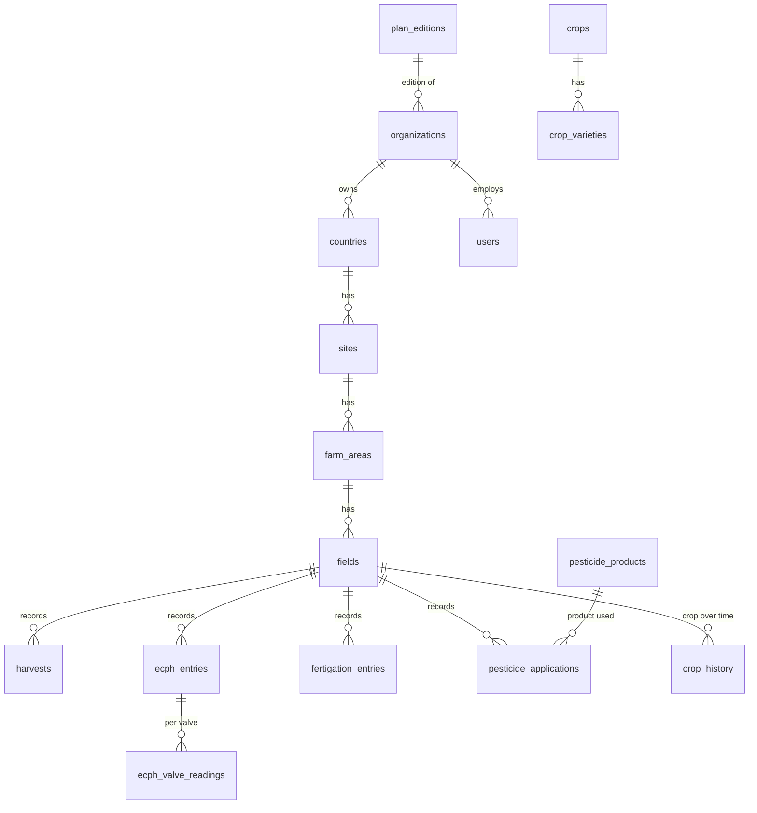

# AgroCloud database map

Generated by `scripts/db-map.py` on 2026-11-21 from a database with every migration applied (159 tables). PostgreSQL 16 with PostGIS; geometry is WGS 84 (SRID 4326).

## How the data hangs together

Rules every table follows:

- Every business row belongs to one organization (`organization_id`, directly or through its field). Queries filter by it.
- A field is found by `Farm_Code + ZONE_ID` from GIS, or by its name; imports match names without spaces, dashes or leading zeros.
- Soft delete where history matters: users, sites and fields keep `deleted_at`; an organization is switched off with `is_active`. Records are corrected through change requests, not deleted.
- Plan limits on sites, fields and users are checked in the database (`agro_plan_limit()` trigger, migration 181).

## Tables by area

### Tenancy, people and access (20)

| Table | Columns | Links to |
|---|---|---|
| `api_keys` | user_id, name, key_hash, key_prefix, permissions, last_used, expires_at, is_active, organization_id | organizations (organization_id), users (user_id) |
| `email_verifications` | user_id, email, token_hash, expires_at, verified_at | users (user_id) |
| `feature_flags` | key, enabled, description, roles, organization_id | organizations (organization_id) |
| `org_catalog_hidden` | organization_id, catalog_type, item_id | organizations (organization_id) |
| `organization_invites` | organization_id, email, role, token_hash, expires_at, created_by, used_at, used_by | organizations (organization_id), users (created_by), users (used_by) |
| `organizations` | name, slug, settings, is_active, plan, plan_overrides, plan_renews_at, billing_email | plan_editions (plan) |
| `password_reset_tokens` | user_id, token_hash, expires_at, used_at | users (user_id) |
| `plan_editions` | key, label, max_sites, max_fields, max_users, modules, sort_order | — |
| `push_tokens` | user_id, token, device_type, device_name, is_active, last_used_at | users (user_id) |
| `refresh_tokens` | user_id, token_hash, expires_at, revoked_at | users (user_id) |
| `system_settings` | key, value, is_encrypted, updated_by | users (updated_by) |
| `team_assignments` | team_leader_id, worker_id, is_active, organization_id | organizations (organization_id), users (team_leader_id), users (worker_id) |
| `user_farm_area_assignments` | user_id, farm_area_id, assigned_by | farm_areas (farm_area_id), users (assigned_by), users (user_id) |
| `user_field_assignments` | user_id, field_id, assigned_by | fields (field_id), users (assigned_by), users (user_id) |
| `user_notifications` | user_id, alert_event_id, title, message, severity, is_read, read_at | alert_events (alert_event_id), users (user_id) |
| `user_permissions` | user_id, module, permission, granted_by, organization_id | organizations (organization_id), users (granted_by), users (user_id) |
| `user_site_assignments` | user_id, site_id, assigned_by | sites (site_id), users (assigned_by), users (user_id) |
| `user_zone_assignments` | user_id, country_id, assigned_by | countries (country_id), users (assigned_by), users (user_id) |
| `users` | email, password_hash, name, role, is_active, last_login, microsoft_id, organization_id, deleted_at, employee_id, pin_hash | organizations (organization_id) |
| `workers` | employee_id, name, category, pin_hash, is_team_leader, is_active, organization_id, site_id, user_id | organizations (organization_id), sites (site_id), users (user_id) |

### Farm structure and seasons (23)

| Table | Columns | Links to |
|---|---|---|
| `breeders` | name, country | — |
| `countries` | name, code, deleted_at, organization_id, geom, key_id, subtype_code, geom_updated_at, geom_source | organizations (organization_id) |
| `crop_history` | field_id, crop_id, start_date, end_date, variety_id, season_id | crop_varieties (variety_id), crops (crop_id), fields (field_id), seasons (season_id) |
| `crop_varieties` | crop_id, name, is_active, breeder_id | breeders (breeder_id), crops (crop_id) |
| `crops` | name, dripper_count, drip_test_count, plant_count | — |
| `farm_area_crops` | farm_area_id, crop_id | crops (crop_id), farm_areas (farm_area_id) |
| `farm_areas` | site_id, name, size, description, deleted_at, polygon, geom, key_id, subtype_code, geom_updated_at, geom_source | sites (site_id) |
| `field_sampling_units` | field_id, sampling_units, updated_by | fields (field_id), users (updated_by) |
| `field_soil_properties` | organization_id, field_id, dataset, depth_cm, value_num, value_text, unit, lon, lat, source, fetched_at | fields (field_id), organizations (organization_id) |
| `field_types` | name, naming_pattern, default_valve_count | — |
| `fields` | farm_area_id, field_type_id, name, current_crop_id, valve_count, area, latitude, longitude, polygon, deleted_at, organization_id, variety_id, gis_external_id, is_nursery, gis_zone_id, gis_farm_code, gis_site_code, gis… | crop_varieties (variety_id), crops (current_crop_id), farm_areas (farm_area_id), field_types (field_type_id), organizations (organization_id) |
| `germination_records` | section_id, variety_id, variety_name, counts, sort_order, organization_id | crop_varieties (variety_id), germination_sections (section_id), organizations (organization_id) |
| `germination_sections` | organization_id, site_id, name, sort_order | organizations (organization_id), sites (site_id) |
| `nursery_sowing_records` | organization_id, site_id, seeding_date, crop_id, variety_id, seed_batch, breeder_id, seeds_per_cell, tray_type, tray_count, growing_media_brand, media_components, seedling_count, germination_pct, ready_to_transplant_d… | breeders (breeder_id), crop_varieties (variety_id), crops (crop_id), organizations (organization_id), sites (site_id) |
| `open_field_planting` | organization_id, seeding_date, field_id, segment, total_area, crop_id, variety_id, crop_type, breeder_id, lot_batch_no, quantity, uom, authorized_by, crop_history_id, status, uprooted_at, uprooted_by, uproot_reason, s… | breeders (breeder_id), crop_history (crop_history_id), crop_varieties (variety_id), crops (crop_id), fields (field_id), organizations (organization_id), planting_records (migrated_to_planting_record_id), seasons (season_id), users (uprooted_by) |
| `plantation_closing_records` | organization_id, closing_sheet_id, requested_date, site_code, fiscal_year, structure_type, farm_name, field_id, section, crop_id, variety_id, plants_or_kg, surface_unit, surface_area, budgeted, remarks, requestor_role… | crop_varieties (variety_id), crops (crop_id), fields (field_id), organizations (organization_id), plantation_closing_sheets (closing_sheet_id), users (approved_by), users (rejected_by), users (submitted_by) |
| `plantation_closing_sheets` | organization_id, site_id, crop_id | crops (crop_id), organizations (organization_id), sites (site_id) |
| `plantation_opening_records` | organization_id, site_id, requested_date, site_code, fiscal_year, structure_type, farm_name, field_id, section, crop_id, variety_id, plants_or_kg, surface_unit, surface_area, budgeted, remarks, requestor_role, request… | crop_history (crop_history_id), crop_varieties (variety_id), crops (crop_id), fields (field_id), organizations (organization_id), sites (site_id), users (farm_manager_approved_by) |
| `planting_records` | organization_id, seeding_date, field_id, segment, total_area, crop_id, variety_id, crop_sub_class, crop_type, breeder, lot_batch_no, pm_quantity, uom, trays_per_hec, rate_per_hec, transplant_date, authorized_by, crop_… | breeders (breeder_id), crop_history (crop_history_id), crop_varieties (variety_id), crops (crop_id), fields (field_id), nursery_sowing_records (sowing_record_id), organizations (organization_id), seasons (season_id), users (uprooted_by) |
| `season_reopen_requests` | organization_id, season_id, reason, requested_by, status, reviewed_by, reviewed_at, reviewer_comment | organizations (organization_id), seasons (season_id), users (requested_by), users (reviewed_by) |
| `seasons` | organization_id, site_id, name, start_date, planned_end_date, end_date, status, closed_at, closed_by, reopened_at, reopened_by | organizations (organization_id), sites (site_id), users (closed_by), users (reopened_by) |
| `sites` | country_id, name, location, total_area, deleted_at, organization_id, gis_site_code, geom, key_id, subtype_code, geom_updated_at, geom_source | countries (country_id), organizations (organization_id) |
| `valves` | field_id, number, name | fields (field_id) |

### Daily records (28)

| Table | Columns | Links to |
|---|---|---|
| `agronomic_thresholds` | crop_id, parameter, enabled, warning_min, warning_max, critical_min, critical_max | crops (crop_id) |
| `cost_entries` | field_id, category, amount, currency, description, date, created_by, organization_id, ipm_application_id | fields (field_id), organizations (organization_id), users (created_by) |
| `cost_targets` | field_id, crop_id, season, target_amount, currency, created_by | crops (crop_id), fields (field_id), users (created_by) |
| `ecph_entries` | field_id, date, time, qty_of_water, cycle, total_water_qty, field_total_water_based_on_drip, dripper_count, organization_id, weather_condition, irrigation_status, crop_id, variety_id, template_id, drip_test_count | crop_varieties (variety_id), crops (crop_id), fields (field_id), form_templates (template_id), organizations (organization_id) |
| `ecph_valve_readings` | ecph_entry_id, valve_number, drip_volume, ec, ph, drain, percent_drain, total_water_based_on_drip, ec_in, ph_in, qty_of_water, cycle, total_water_qty | ecph_entries (ecph_entry_id) |
| `equipment` | name, type, identifier, is_active, organization_id | organizations (organization_id) |
| `fertigation_entries` | field_id, recipe_id, date, week_number, flow_rate, frequency, valves_count, daily_water, fertilizers, total_fertilizer, cumulative, organization_id, crop_id, variety_id, worker_id | crop_varieties (variety_id), crops (crop_id), fields (field_id), organizations (organization_id), recipes (recipe_id), workers (worker_id) |
| `fertigation_field_groups` | organization_id, site_id, name, field_ids, default_recipe_id | organizations (organization_id), recipes (default_recipe_id), sites (site_id) |
| `fertilizer_application_records` | field_id, date, segment_id, area_ha, crop, fertilizer_product_id, fertilizer_name, fertilizer_type_conc, total_kg, rate_per_ha, qty_tons, operator_name, authorized_by, mis_no, doc_no, site_id, organization_id | fertilizer_products (fertilizer_product_id), fields (field_id), organizations (organization_id), sites (site_id) |
| `fertilizer_application_workbooks` | site_id, farm_name | sites (site_id) |
| `fertilizer_products` | organization_id, name, type_conc, is_active | organizations (organization_id) |
| `harvest_varieties` | harvest_id, variety, quantity, grade, variety_id | crop_varieties (variety_id), harvests (harvest_id) |
| `harvests` | field_id, date, total_quantity, notes, organization_id, crop_id, variety_id, start_time, end_time, shift_number, batch_number, segment_id, harvested_area_ha, packhouse, authorized_by, extra_data, open_field_planting_i… | crop_varieties (variety_id), crops (crop_id), fields (field_id), open_field_planting (open_field_planting_id), organizations (organization_id), planting_records (planting_record_id) |
| `inventory_items` | name, category, unit, min_stock_level, current_stock, cost_per_unit, currency, supplier, is_active, created_by, organization_id | organizations (organization_id), users (created_by) |
| `inventory_transactions` | item_id, type, quantity, balance_after, reference_type, reference_id, date, notes, created_by, organization_id | inventory_items (item_id), organizations (organization_id), users (created_by) |
| `irrigation_entries` | organization_id, site_id, field_id, date, location_label, valve_range, week_number, method, flow_rate_m3, operator_name, authorized_by, water_qty_m3, frequency, daily_water, fertilizer_type, fertilizer_qty | fields (field_id), organizations (organization_id), sites (site_id) |
| `irrigation_month_sheets` | site_id, year, month, farm_name | sites (site_id) |
| `irrigation_records` | month_sheet_id, field_id, date, segment_id, area_ha, crop, flow_rate_m3_hr, cycle_duration_hr, volume_m3, authorized_by | fields (field_id), irrigation_month_sheets (month_sheet_id) |
| `pump_room_deleted_sheets` | site_id, record_type, month_year, record_count, deleted_at, deleted_by, restored_at | sites (site_id), users (deleted_by) |
| `pump_room_electricity` | site_id, record_date, meter_id, usage_area, reading_1, usage_1, reading_2, usage_2, deleted_at, deletion_id, pumps | sites (site_id) |
| `pump_room_fogger` | site_id, record_date, meter_id, usage_area, pumps, reading_1, usage_1, reading_2, usage_2, deleted_at, deletion_id | sites (site_id) |
| `pump_room_water` | site_id, record_date, meter_id, usage_area, deleted_at, deletion_id, pumps, reading_1, usage_1, reading_2, usage_2 | sites (site_id) |
| `recipe_fertilizers` | recipe_id, name, dose, kg_per_liter, element, concentration, tank_volume, quantity_per_1000l, element_ppm | recipes (recipe_id) |
| `recipes` | name, description, tank_volume, cycles, element_ppm, deleted_at, status, approved_by, approved_at | users (approved_by) |
| `site_pump_room_config` | site_id, water_pump_count, electricity_pump_count, water_pump_labels, electricity_pump_labels, fogger_pump_count, fogger_pump_labels | sites (site_id) |
| `soil_sensor_readings` | field_id, date, moisture_pct, temperature_c, ec_dsm, ph, depth_cm, source, notes, organization_id | fields (field_id), organizations (organization_id) |
| `weather_cache` | latitude, longitude, date, data, source, fetched_at | — |
| `weather_logs` | country_id, site_id, field_id, date, latitude, longitude, max_temp, min_temp, avg_temp, feels_like, avg_rh, rainfall, pressure, wind_speed, wind_direction, clouds, description, source, notes | countries (country_id), fields (field_id), sites (site_id) |

### Crop protection (IPM) (31)

| Table | Columns | Links to |
|---|---|---|
| `bio_control_products` | name, agent_type, form_type, target_pests, application_rate_guide, is_active, organization_id, created_by | organizations (organization_id), users (created_by) |
| `bio_control_releases` | field_id, product_id, release_date, quantity, form_type, target_pest, pre_release_pest_pct, notes, organization_id, created_by | bio_control_products (product_id), fields (field_id), organizations (organization_id), users (created_by) |
| `bio_products_catalog` | item_code, item_name, organization_id, is_active, per_package, price_per_package, uom_id | bio_uom (uom_id), organizations (organization_id) |
| `bio_record_entries` | field_setup_id, product_column_id, week_number, per_m2, units, created_by, pending_per_m2, pending_units, pending_clear, pending_by, pending_at, rejected_reason, rejected_by, rejected_at | bio_record_field_products (product_column_id), bio_record_field_setup (field_setup_id), users (created_by), users (pending_by), users (rejected_by) |
| `bio_record_field_products` | field_setup_id, product_catalog_id, item_code, product_name, per_package, price_per_package, sort_order, uom_id | bio_products_catalog (product_catalog_id), bio_record_field_setup (field_setup_id), bio_uom (uom_id) |
| `bio_record_field_setup` | organization_id, field_id, crop_id, year, surface_m2, plants_per_m2, number_of_plants, start_week, created_by, start_date, week_count, season_id | crops (crop_id), fields (field_id), organizations (organization_id), seasons (season_id), users (created_by) |
| `bio_uom` | organization_id, name | organizations (organization_id) |
| `bumble_bee_box_inspections` | field_id, organization_id, inspection_date, boxes_100, boxes_80, boxes_60, boxes_40, boxes_20, boxes_0, total_boxes, notes, created_by | fields (field_id), organizations (organization_id), users (created_by) |
| `bumble_bee_deployments` | field_id, date_placed, box_count, date_removed, notes, organization_id, created_by, boxes_before, boxes_removed, boxes_added, box_count_total | fields (field_id), organizations (organization_id), users (created_by) |
| `bumble_bee_incoming_orders` | site_id, organization_id, quantity_expected, expected_delivery_date, status, notes, received_at, created_by, order_date, quantity_received, quantity_on_hand_before, quantity_on_hand_after | organizations (organization_id), sites (site_id), users (created_by) |
| `bumble_bee_inventory_adjustments` | site_id, organization_id, delta, reason, reference_id, quantity_after, created_by | organizations (organization_id), sites (site_id), users (created_by) |
| `bumble_bee_site_inventory` | site_id, organization_id, quantity_on_hand, updated_by | organizations (organization_id), sites (site_id), users (updated_by) |
| `ipm_change_requests` | organization_id, entity_type, entity_id, action, requested_by, reason, proposed_payload, snapshot_before, status, reviewed_by, reviewed_at, reviewer_comment | users (requested_by), users (reviewed_by) |
| `pest_catalog_group_members` | member_id, group_id | pest_disease_catalog (group_id), pest_disease_catalog (member_id) |
| `pest_disease_catalog` | name, category, description, recommended_action, is_custom, is_active, organization_id, created_by, warning_threshold, critical_threshold, abbreviation, source_pest_id, match_pattern, sort_order, include_in_summary | organizations (organization_id), pest_disease_catalog (source_pest_id), users (created_by) |
| `pesticide_applications` | field_id, product_id, application_date, phi_end_date, dosage, dosage_unit, concentration, application_method, target_pest, operator_name, weather_conditions, ppe_used, authorized_by, approval_status, approved_at, reje… | fields (field_id), form_templates (template_id), organizations (organization_id), pest_disease_catalog (justification_catalog_id), pesticide_products (product_id), users (authorized_by), users (created_by) |
| `pesticide_products` | name, active_ingredient, formulation_type, phi_days, manufacturer, registration_number, target_pests, safety_notes, is_active, organization_id, created_by, target_crops, max_individual_dose, max_total_dose, max_applic… | organizations (organization_id), pesticide_products (source_product_id), users (created_by) |
| `phi_audit_acknowledgements` | harvest_id, application_id, status, notes, acknowledged_by, acknowledged_at | harvests (harvest_id), pesticide_applications (application_id), users (acknowledged_by) |
| `phi_conflict_notifications` | harvest_id, application_id, notification_kind | harvests (harvest_id) |
| `phi_notifications` | application_id, field_id, notification_type, sent_at, recipient_user_id, organization_id | fields (field_id), organizations (organization_id), pesticide_applications (application_id), users (recipient_user_id) |
| `scouting_growth_stage` | scouting_report_id, number_of_trusses, number_of_stems, stem_thickness, avg_fruit_weight, fruits_per_plant | scouting_reports (scouting_report_id) |
| `scouting_observations` | scouting_report_id, pest_disease_id, pest_name, category, sampling_unit, sampling_method, count_1, count_2, count_3, count_4, count_5, total, average, percent, count_6, count_7, count_8, count_9, count_10 | pest_disease_catalog (pest_disease_id), scouting_reports (scouting_report_id) |
| `scouting_photos` | scouting_report_id, file_path, file_name, file_size, mime_type, gps_lat, gps_lng, caption | scouting_reports (scouting_report_id) |
| `scouting_reports` | field_id, scout_user_id, report_date, pest_disease_id, custom_pest_name, infestation_pct, severity, notes, gps_lat, gps_lng, status, reviewed_by, reviewed_at, organization_id, report_time, crop_name, variety, area_var… | fields (field_id), organizations (organization_id), pest_disease_catalog (pest_disease_id), scouting_reports (previous_report_id), users (reviewed_by), users (scout_user_id) |
| `scouting_thresholds` | pest_disease_id, crop_id, warning_pct, critical_pct, notes, organization_id, created_by | crops (crop_id), organizations (organization_id), pest_disease_catalog (pest_disease_id), users (created_by) |
| `scouting_trap_cards` | scouting_report_id, card_number, insect_type, trap_location, monday, tuesday, wednesday, thursday, friday, saturday, sunday, total | scouting_reports (scouting_report_id) |
| `site_bio_products` | site_id, product_id, price_per_package, is_active | bio_products_catalog (product_id), sites (site_id) |
| `site_pesticide_products` | site_id, product_id, unit_price, is_active | pesticide_products (product_id), sites (site_id) |
| `site_product_crop_phi` | site_id, product_id, crop_name, phi_days, created_by | pesticide_products (product_id), sites (site_id), users (created_by) |
| `spray_work_order_items` | work_order_id, sort_order, field_id, segment, product_id, rate, date_of_application, phi_days, group_id, is_mixture_child, start_time, end_time, total_product_qty, total_water_qty, actual_qty, machinery_ref, quality_c… | fields (field_id), pesticide_products (product_id), spray_work_orders (work_order_id) |
| `spray_work_orders` | work_order_number, site_id, application_type, date_issued, justification, status, rejection_reason, important_instructions, issued_by, assigned_to, completed_by, completed_at, approved_by, approved_at, organization_id… | sites (site_id), users (approved_by), users (assigned_to), users (completed_by), users (created_by), users (issued_by) |

### Team and tasks (10)

| Table | Columns | Links to |
|---|---|---|
| `manpower_activities` | name, default_unit, is_active, pivot_column | — |
| `manpower_activity_aliases` | organization_id, source_key, source_name, activity_name | organizations (organization_id) |
| `manpower_activity_references` | organization_id, site_id, activity, crop, variety, unit, target, created_by, sheet | organizations (organization_id), sites (site_id) |
| `manpower_rates` | organization_id, site_id, category, worker_id, rate_per_hour, effective_from, note, created_by, deleted_at, deleted_by | organizations (organization_id), sites (site_id), users (created_by), users (deleted_by), workers (worker_id) |
| `manpower_records` | record_date, worker_id, task_sequence, activity, unit, variety, location, section, start_time, end_time, target, actual, work_hours, overtime, total_hours, submitted_by, created_by, deleted_at, organization_id, approv… | organizations (organization_id), users (reviewed_by), workers (submitted_by), workers (worker_id) |
| `shift_templates` | name, shift_type, start_time, end_time, days_of_week, created_by | users (created_by) |
| `shifts` | user_id, field_id, shift_type, start_time, end_time, date, notes, created_by, organization_id | fields (field_id), organizations (organization_id), users (created_by), users (user_id) |
| `task_checklists` | task_id, item, is_completed, completed_by, completed_at, sort_order | tasks (task_id), users (completed_by) |
| `task_comments` | task_id, user_id, comment | tasks (task_id), users (user_id) |
| `tasks` | title, description, task_type, priority, status, assigned_to, assigned_by, field_id, due_date, completed_at, organization_id, parent_task_id, delegated_by, delegated_at, team_leader_id | fields (field_id), organizations (organization_id), tasks (parent_task_id), users (assigned_by), users (assigned_to), users (delegated_by), users (team_leader_id) |

### GIS, remote sensing and devices (15)

| Table | Columns | Links to |
|---|---|---|
| `drone_flights` | field_id, flight_date, pilot, altitude, notes, created_by, organization_id | fields (field_id), organizations (organization_id), users (created_by) |
| `drone_images` | flight_id, filename, url, storage_key, image_type, metadata | drone_flights (flight_id) |
| `feed_keys` | organization_id, form, key_hash, key_prefix, created_by, last_used, revoked_at | — |
| `form_feeds` | organization_id, form, arcgis_table_url, arcgis_layer_id, sync_mode, include_names, last_synced_at, last_sync_count, last_error | — |
| `form_registry` | form_id, form_key, form_path, title_en, title_ar, category, ui_route, template_slug, organization_id, status, version, description | organizations (organization_id) |
| `form_registry_tables` | form_id, table_name, role, parent_table, parent_key, date_column, attachment_entity, template_column, is_default | form_registry (form_id) |
| `geo_domain_values` | domain_key, code, name_en, name_ar, sort_order, active | geo_domains (domain_key) |
| `geo_domains` | key, name_en, name_ar, kind, min_value, max_value, unit | — |
| `geo_edit_history` | organization_id, class_key, feature_id, key_id, operation, geom_before, geom_after, attrs, edited_by, edited_at | — |
| `geo_subtypes` | class_key, code, name_en, name_ar, key_prefix, fill_color, line_color, sort_order, active | — |
| `gis_features` | layer_id, external_id, geometry, properties, linked_field_id, linked_farm_area_id | farm_areas (linked_farm_area_id), fields (linked_field_id), gis_layers (layer_id) |
| `gis_layers` | name, source_type, source_url, layer_index, file_path, original_filename, geojson_data, style, attribute_mapping, sync_interval_minutes, last_synced_at, sync_status, sync_error, is_visible, layer_order, auth_token, cr… | organizations (organization_id), users (created_by) |
| `gps_positions` | equipment_id, latitude, longitude, speed, heading, recorded_at | equipment (equipment_id) |
| `john_deere_connections` | organization_id, environment, client_id, client_secret_enc, redirect_uri, scopes, access_token_enc, refresh_token_enc, token_expires_at, oauth_state, oauth_state_expires_at, jd_org_id, jd_org_name, field_mapping, conn… | organizations (organization_id), users (connected_by) |
| `john_deere_field_operations` | organization_id, jd_operation_id, jd_org_id, jd_field_id, jd_field_name, field_id, operation_type, crop_season, crop_name, start_date, end_date, modified_time, measurements, products, varieties, raw, synced_at | fields (field_id), organizations (organization_id) |

### AI assistant (3)

| Table | Columns | Links to |
|---|---|---|
| `ai_actions` | organization_id, user_id, conversation_id, kind, payload, summary, status, result, error, decided_at | ai_conversations (conversation_id), organizations (organization_id), users (user_id) |
| `ai_conversations` | organization_id, user_id, title | organizations (organization_id), users (user_id) |
| `ai_messages` | conversation_id, role, content, artifacts, sources, tool_calls, input_tokens, output_tokens | ai_conversations (conversation_id) |

### Forms, reports and notifications (18)

| Table | Columns | Links to |
|---|---|---|
| `alert_events` | rule_id, entity_type, entity_id, field_id, severity, title, message, value, acknowledged_by, acknowledged_at | alert_rules (rule_id), fields (field_id), users (acknowledged_by) |
| `alert_preferences` | user_id, alert_type, in_app, email, push | users (user_id) |
| `alert_rules` | name, entity_type, metric, operator, threshold, severity, notify_roles, is_active, created_by, organization_id | organizations (organization_id), users (created_by) |
| `api_integration_fields` | integration_id, field_id, station_id, is_shared, config_override | api_integrations (integration_id), fields (field_id) |
| `api_integrations` | name, type, provider, base_url, auth_type, auth_config, polling_interval_minutes, data_mapping, is_active, last_synced_at, last_error, created_by, organization_id | organizations (organization_id), users (created_by) |
| `api_sync_logs` | integration_id, started_at, finished_at, status, synced_count, skipped_count, error_count, errors, triggered_by | api_integrations (integration_id) |
| `app_summary_content` | intro_text, closing_text, summary_rows, contents_groups, updated_by | users (updated_by) |
| `attachments` | entity, entity_id, filename, original_name, mime_type, size_bytes, url, storage_key, uploaded_by | users (uploaded_by) |
| `audit_logs` | user_id, action, entity, entity_id, changes, metadata, ip_address, user_agent | users (user_id) |
| `entity_comments` | entity_type, entity_id, user_id, comment, organization_id | organizations (organization_id), users (user_id) |
| `file_blobs` | content, mime_type, size_bytes | — |
| `form_templates` | organization_id, slug, name, category, description, icon, route_path, columns_config, is_system, created_by_site_id, form_id | form_registry (form_id), organizations (organization_id), sites (created_by_site_id) |
| `notification_preferences` | user_id, push_enabled, email_enabled, alert_notifications, reminder_notifications, info_notifications, quiet_hours_start, quiet_hours_end | users (user_id) |
| `notifications` | user_id, title, body, data, type, status, sent_at, read_at | users (user_id) |
| `scheduled_reports` | name, report_type, filters, frequency, recipients, last_sent, next_run, is_active, created_by | users (created_by) |
| `site_form_templates` | site_id, template_id, is_default, sort_order, is_visible | form_templates (template_id), sites (site_id) |
| `webhook_deliveries` | webhook_id, event, payload, status_code, response, delivered_at | webhooks (webhook_id) |
| `webhooks` | user_id, url, secret, events, is_active, organization_id | organizations (organization_id), users (user_id) |

### Training (internship) (11)

| Table | Columns | Links to |
|---|---|---|
| `lesson_question_bank` | lesson_id, question_text, options, correct_index, explanation | training_lessons (lesson_id) |
| `student_seen_questions` | student_id, question_id, seen_at | lesson_question_bank (question_id), users (student_id) |
| `training_ai_chats` | student_id, module_id, messages | training_modules (module_id), users (student_id) |
| `training_attempts` | quiz_id, student_id, answers, score, total_questions, correct_count, started_at, completed_at | training_quizzes (quiz_id), users (student_id) |
| `training_lesson_visits` | student_id, lesson_id, started_at, ended_at, duration_seconds | training_lessons (lesson_id), users (student_id) |
| `training_lessons` | module_id, title, content, sort_order, duration_minutes, created_by | training_modules (module_id), users (created_by) |
| `training_modules` | title, description, sort_order, icon, is_active | — |
| `training_progress` | student_id, lesson_id, module_id, completed_at, total_time_seconds, visit_count | training_lessons (lesson_id), training_modules (module_id), users (student_id) |
| `training_questions` | quiz_id, question_type, question_text, options, correct_answer, explanation, sort_order | training_quizzes (quiz_id) |
| `training_quiz_lessons` | quiz_id, lesson_id | training_lessons (lesson_id), training_quizzes (quiz_id) |
| `training_quizzes` | module_id, title, quiz_type, time_limit_minutes, pass_percentage, is_active, created_by, lesson_id | training_lessons (lesson_id), training_modules (module_id), users (created_by) |

